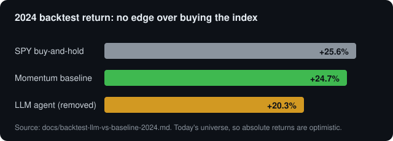
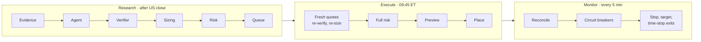

# Evan's Trading Agent

[](https://github.com/evanyap7/evans-trading-agent/actions/workflows/ci.yml)

I built a trading system for a small **Webull Singapore** account to find an edge. **It found none.**

The project started as one question: is there an edge here, and how would I know? So I built three things: a rule-based momentum agent, a deterministic risk and execution layer, and a walk-forward research harness that tests every idea against luck-adjusted statistics before it gets near money. Four independent studies on liquid US equities and ETFs all say the same thing, and I would rather report that plainly than tune until a chart looks good.

**Status:** first real orders placed 2026-09-23, one share at a time. Live trading paused with the kill switch on 2026-10-01.



## Research findings

| Study | Question | Result | Report |
|---|---|---|---|
| Classic quant signals | Do momentum, reversal, low-vol or trend following beat buy-and-hold out of sample? | **No.** Deflated Sharpe 0.05 to 0.65, all below the ~0.95 bar. Trend following cut risk (a third of the volatility, half the drawdown), not return. | [report](docs/quant-research-report.md) |
| Insider buying | Do SEC Form 4 open-market purchases predict returns? | **No usable edge.** Small raw effect, mostly survivorship and noise, gone after sizing, stops and risk limits. | [study](docs/insider-signal-study.md) |
| LLM agent | Does a Claude agent (Haiku screen, Opus proposal) beat a free momentum baseline? | **No.** Sharpe lead of 0.03 (noise), lower win rate, about $27 a year in API cost. Removed. | [backtest](docs/backtest-llm-vs-baseline-2024.md) |
| Momentum baseline | Does the live rule set beat SPY? | **Matches it.** +66.8% vs +70.1% over 2022 to 2026 at roughly half the drawdown. | same reports |

### How I made the negative result trustworthy

- **No lookahead, tested.** A test rewrites the future of a price series and asserts past signals do not move.
- **Walk-forward selection.** Pick parameters on 2 years, score on the next 6 months, roll. Only out-of-sample stretches are reported.
- **Luck correction.** Deflated Sharpe ratio (Bailey and Lopez de Prado) plus a block-bootstrap interval. Every earlier grid and study raises the hurdle for the next.
- **Stated costs and biases.** 10 bps on stocks, 5 bps on ETFs, 50 bps a year borrow. The universe is today's survivors, so absolute returns are inflated.

The maths is in [algorithmic_trading_maths.md](docs/algorithmic_trading_maths.md).

## System design



The agent only proposes `OPEN`, `CLOSE` or `NO_TRADE`. Deterministic code verifies, sizes and approves or rejects. The agent never picks a quantity or goes around the risk envelope.

| Concern | Approach |
|---|---|
| Verification | Grounding, freshness, price collar, ATR stop, R:R, net edge after costs (`verifier.py`) |
| Sizing | Fractional Kelly, capped per trade and at 6% total portfolio risk (`portfolio.py`) |
| Risk limits | All in `config/risk_limits.yaml`; absurd values (shorts, margin, over 5% per trade) refuse to load |
| Execution | Deterministic client order IDs, preview check, no blind retries, 5xx treated as ambiguous and reconciled |
| Stops | Broker-side GTC stop after every fill, re-armed if missing, ratchets up only |
| Audit | Append-only, hash-chained SQLite ledger with a tamper check |
| Fail-safe | Reconciliation, auto and manual kill switch, drawdown breaker |

About 6,500 lines of Python and **191 tests**, run offline in CI on every push.

## Cash sweep backtest

The agent held only 17 to 32% of the account, so I tested parking idle cash in an index ETF. $900 start, 2024-01-02 to 2026-09-25:

| | Return | Max drawdown |
|---|---|---|
| No sweep | +8.5% | -5.5% |
| SGOV sweep | +18.3% | -5.3% |
| SPYM sweep | +60.8% | -14.5% |
| SPY buy-and-hold | +68.5% | -18.8% |

The sweep is mostly market beta. Backtests here are optimistic: today's universe, no replayed news, few regimes.

## Run it

```bash
uv sync --extra webull
cp .env.example .env                           # fill in yourself; never paste keys into a chat
uv run pytest                                  # 191 passing, no credentials needed
uv run trading-agent research --broker sim     # offline dry run on synthetic data
uv run trading-agent quant-research            # the walk-forward study
uv run trading-agent backtest --start 2024-01-02
```

Going live is gated step by step: UAT read-only, shadow mode, UAT orders, then production. Real orders need `WEBULL_ENVIRONMENT=prod`, `TRADING_MODE=broker` **and** `live_trading.enabled: true`; with any one off, entries are risk-rejected. Handy commands: `status`, `kill --reason "..."`, `verify-ledger`.

> Not investment advice. The default mode is shadow, and the evidence so far says to hold the index.
